# ERP Droguerie : Gestion des Ventes, de la Caisse, du Stock et des Clients


Application qui remplace les carnets papier d'une droguerie familiale : bons de vente, encaissement, suivi du stock et des crédits clients.

Le projet est découpé en **4 microservices** indépendants, chacun propriétaire de ses données, qui communiquent avec **OpenFeign** et se découvrent grâce à **Eureka**.

---

## 1. Le besoin

Dans la droguerie, tout se fait sur papier :

- le **vendeur** prépare un bon avec les produits demandés par le client ;
- la **caissière** encaisse le bon, et note dans un carnet les clients qui paient plus tard ;
- la **gérante** ne sait jamais exactement ce qui reste en stock, ni combien chaque client lui doit.

Problèmes : produits vendus alors qu'ils sont en rupture, dettes oubliées, clients qui dépassent le crédit que la gérante voulait leur accorder.

📄 [Cahier des charges](documentation/CDC.docx)

### Règles de gestion principales

| Règle | Où elle est appliquée |
|---|---|
| Un bon ne peut contenir que des produits disponibles en stock | service-ventes |
| Un produit vendu à la pièce ne peut pas être vendu en quantité décimale | service-ventes |
| Le stock est retiré **au moment du paiement**, pas à la préparation du bon | service-ventes |
| Seul un bon en attente peut être annulé ou encaissé | service-ventes |
| Une vente à crédit n'est possible que pour un client enregistré | service-caisse |
| La dette d'un client ne doit jamais dépasser son plafond de crédit | service-caisse |
| On ne peut pas rembourser plus que ce qui reste dû sur une facture | service-caisse |
| Le stock ne peut jamais devenir négatif | service-produits |

---

## 2. Planification

Le projet est planifié sur 4 semaines et suivi en Scrum dans **Jira** : 5 epics, 15 tâches, 3 sprints.

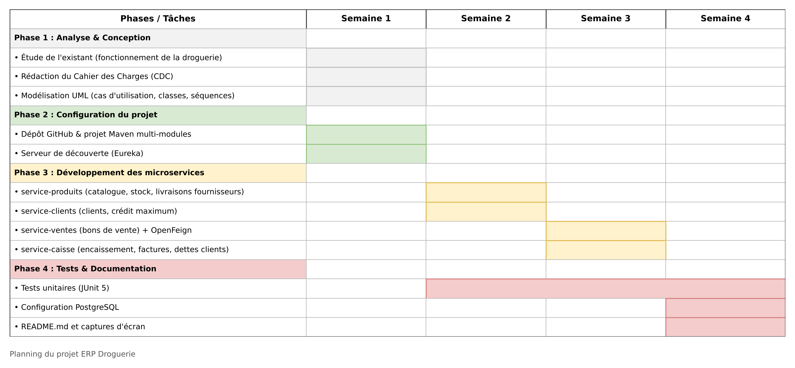

---

## 3. Conception UML

### Cas d'utilisation
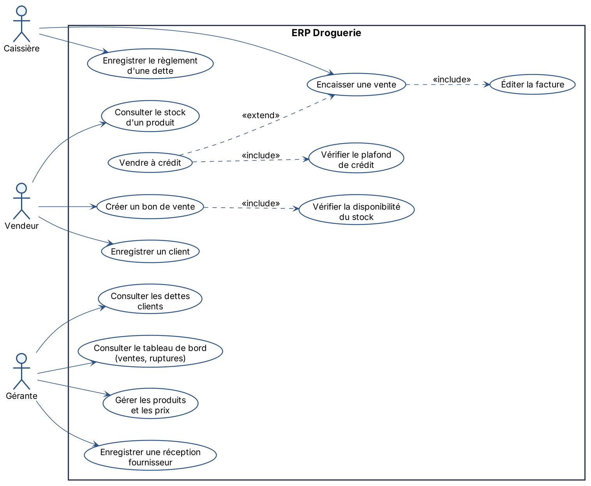

### Diagramme de classes
Chaque microservice possède ses propres classes. Un `BonDeVente` ne garde que l'identifiant du client (`clientId`) et une `LigneVente` que celui du produit (`produitId`) : **pas de clé étrangère entre les bases**, les informations sont demandées au service propriétaire avec OpenFeign.

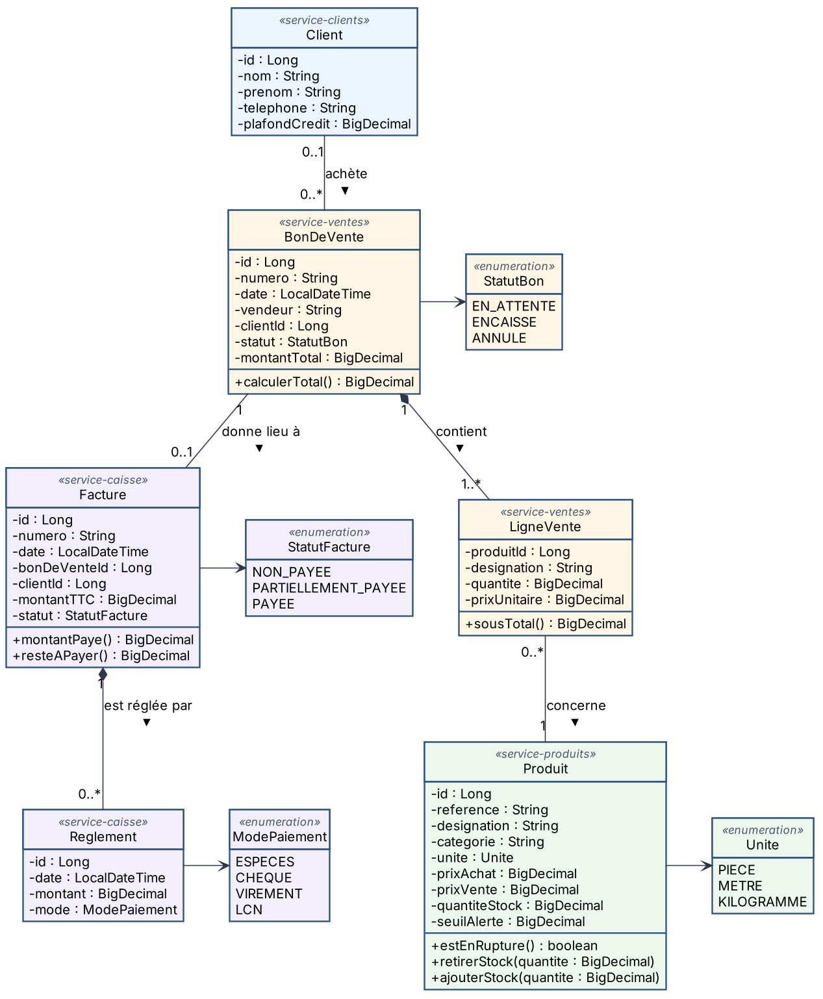

### Séquence : créer un bon de vente
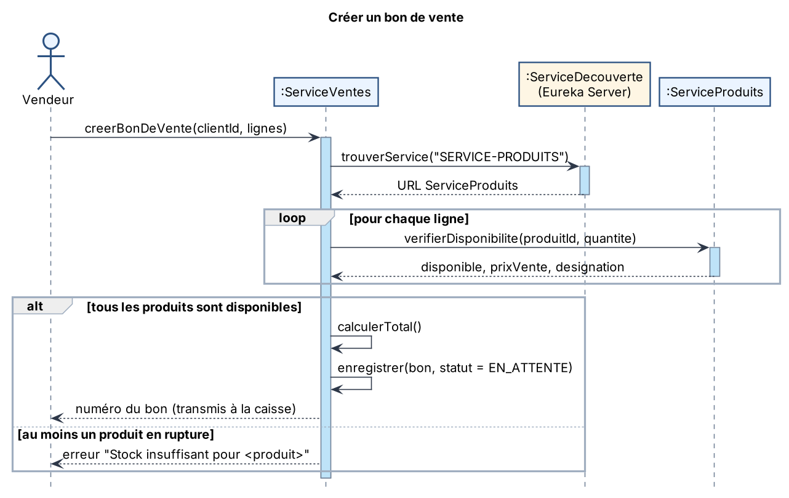

### Séquence : encaisser une vente (avec crédit)
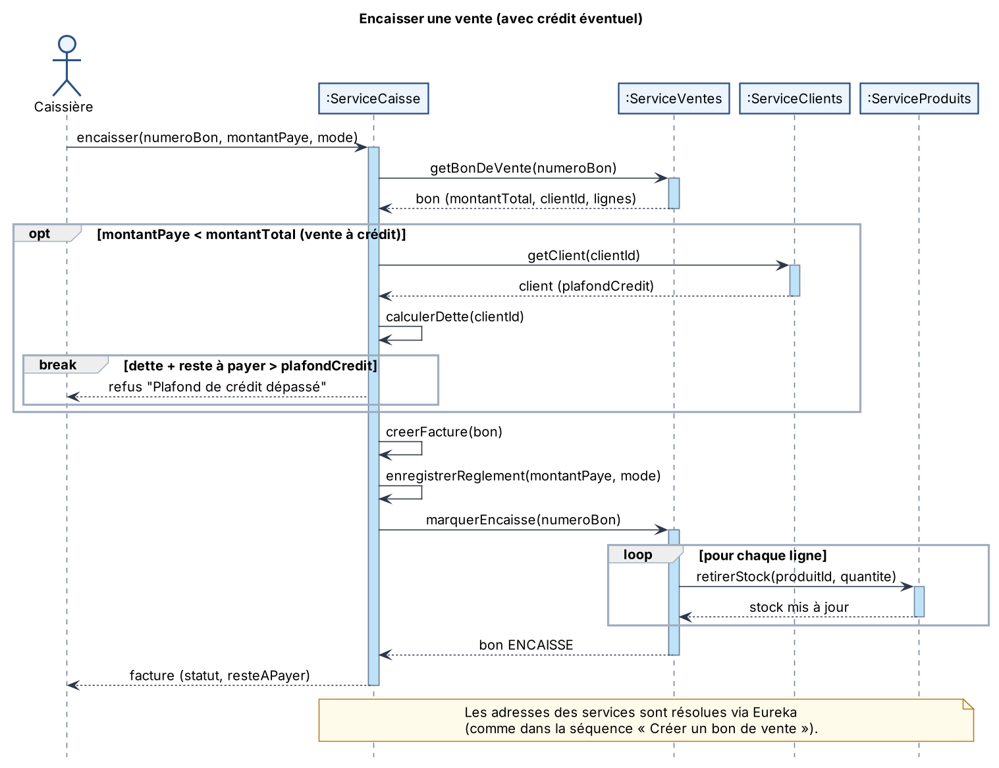

---

## 4. Architecture

| Microservice | Port | Rôle |
|---|---|---|
| `service-decouverte` | 8761 | Annuaire Eureka : chaque service s'y enregistre |
| `service-produits` | 8081 | Catalogue, prix, unités, stock, seuils d'alerte, livraisons fournisseurs |
| `service-clients` | 8082 | Clients et plafond de crédit |
| `service-ventes` | 8083 | Bons de vente préparés par le vendeur |
| `service-caisse` | 8084 | Encaissement, factures, ventes à crédit, remboursements, dettes |

### Comment les services collaborent à l'encaissement

```
Caissière ──► service-caisse
                 │ 1. plafond du client ?          ──► service-clients
                 │ 2. calcule la dette (ses propres factures)
                 │ 3. clôturer le bon               ──► service-ventes
                 │                                        │ retirer le stock ──► service-produits
                 │ 4. crée la facture et le règlement
```

**Principe :** chaque service est propriétaire de ses données. Quand il a besoin d'une information qui ne lui appartient pas, il la demande au service propriétaire.

### Choix techniques
- **Service Discovery (Eureka)** : les services s'appellent par leur nom (`@FeignClient(name = "service-produits")`), Eureka fournit l'adresse.
- **OpenFeign** : appels REST entre services, écrits comme de simples interfaces Java.
- **Verrouillage optimiste** (`@Version` sur `Produit`) : protège le stock si deux ventes arrivent en même temps.
- **Erreurs normalisées (RFC 7807)** : 400 données invalides, 404 introuvable, 409 règle métier non respectée, 503 service indisponible. Les messages d'erreur d'un service sont relayés au service appelant.
- **Prix figé sur le bon** : la désignation et le prix sont copiés dans la ligne de vente, pour garder le prix réellement payé.

### Technologies

| Catégorie | Outils |
|---|---|
| Langage | Java 17 |
| Frameworks | Spring Boot 3.5, Spring Data JPA, Bean Validation |
| Spring Cloud | Eureka (serveur et client), OpenFeign |
| Base de données | H2 (développement) |
| Documentation API | Swagger (springdoc-openapi) |
| Tests | JUnit 5, AssertJ |
| Outils | Maven, Git/GitHub, IntelliJ IDEA, Jira |

---

## 5. Démonstration

### Les 4 services enregistrés dans Eureka
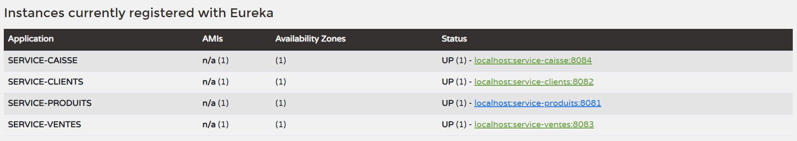

### Scénario complet testé avec Swagger

| # | Scénario | Résultat |
|---|---|---|
| 1 | Le vendeur crée un bon : 2 ampoules + 5,5 m de câble pour Ahmed | `201`, bon BV-00001 EN_ATTENTE, total 68,50 DH |
| 2 | Bon avec 9 999 ampoules | `409` « Stock insuffisant » |
| 3 | Ahmed paie 10 DH, le reste passe en crédit | `201`, facture PARTIELLEMENT_PAYEE, reste 58,50 DH, stock retiré |
| 4 | Consulter la dette d'Ahmed | 58,50 DH |
| 5 | Ahmed rembourse 20 DH | reste à payer 38,50 DH |
| 6 | Vente à crédit pour Khadija (plafond 0 DH) | `409` « Plafond de crédit dépassé » |

<details>
<summary><b>Voir les captures</b></summary>

**Produits : catalogue**
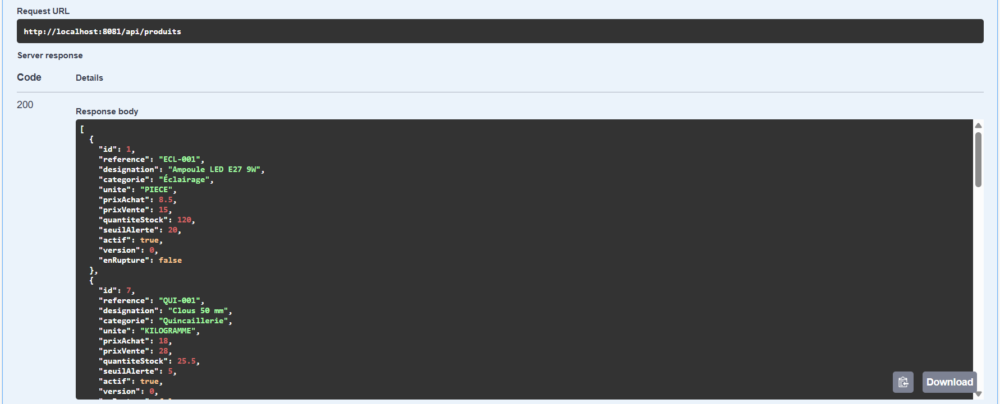

**Clients**
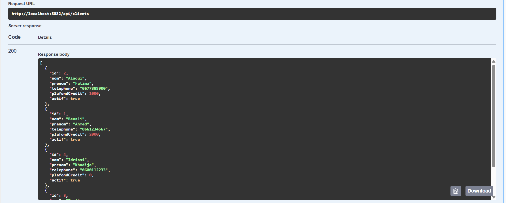

**1. Création d'un bon de vente**
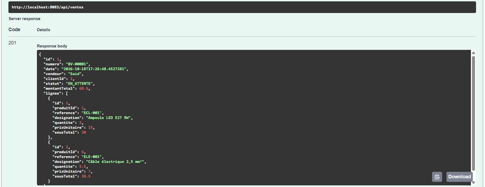

**2. Stock insuffisant**
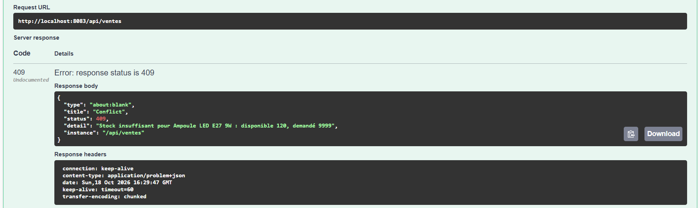

**3. Encaissement avec crédit**
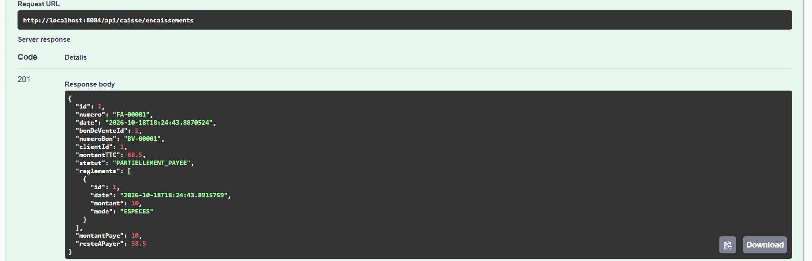

**4. Dette du client**
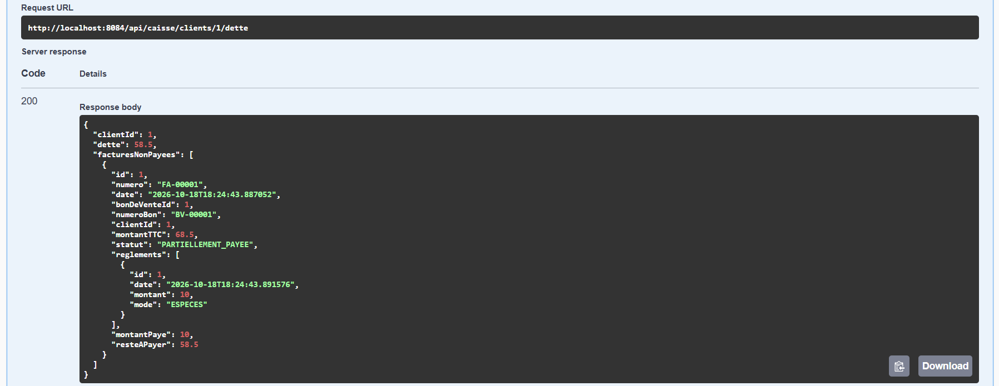

**5. Remboursement**
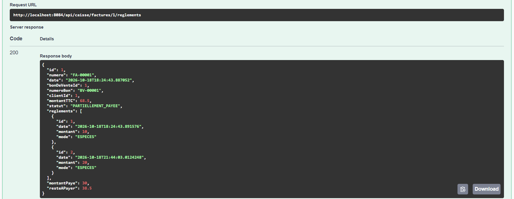

**6. Plafond de crédit dépassé**
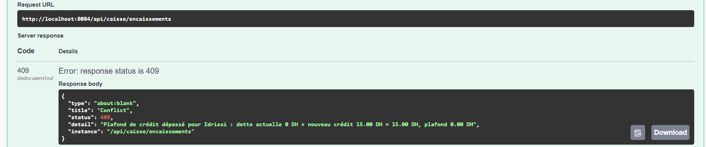

</details>

### Tests unitaires
Les règles métier sont testées sans démarrer l'application : stock, total du bon, statuts, paiements partiels, plafond.

| Service | Classe de test | Tests |
|---|---|---|
| Produits | `ProduitTest` | 6 |
| Clients | `ClientTest` | 4 |
| Ventes | `BonDeVenteTest` | 6 |
| Caisse | `FactureTest` | 5 |

<details>
<summary><b>Voir les résultats</b></summary>

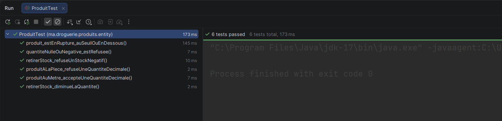
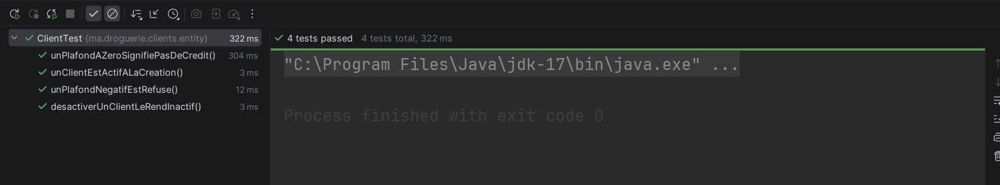
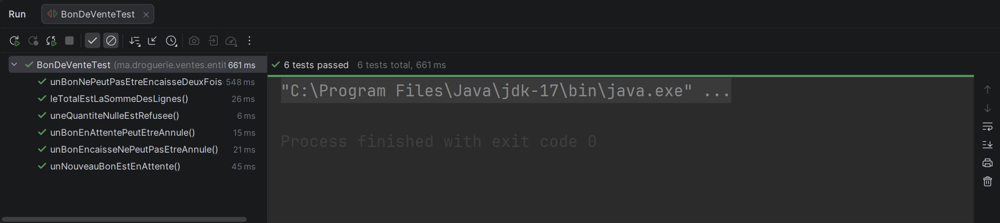
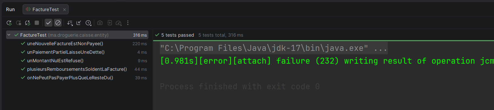

</details>

---

## 6. Lancer le projet

Prérequis : Java 17 et Maven (ou IntelliJ IDEA).

Démarrer les services **dans cet ordre** :

1. `ServiceDecouverteApplication` (Eureka)
2. `ServiceProduitsApplication`
3. `ServiceClientsApplication`
4. `ServiceVentesApplication`
5. `ServiceCaisseApplication`

Des produits et des clients de démonstration sont chargés automatiquement au démarrage.

| Service | Adresse |
|---|---|
| Console Eureka | http://localhost:8761 |
| Swagger Produits | http://localhost:8081/swagger-ui.html |
| Swagger Clients | http://localhost:8082/swagger-ui.html |
| Swagger Ventes | http://localhost:8083/swagger-ui.html |
| Swagger Caisse | http://localhost:8084/swagger-ui.html |

Lancer tous les tests : `mvn test`

---

## 7. Structure du dépôt

```
├── documentation/
│   ├── CDC.docx                 (cahier des charges)
│   ├── planningGantt.png
│   ├── diagrammesUML/           (cas d'utilisation, classes, séquences)
│   └── captures/                (Eureka, Swagger, tests)
├── service-decouverte/          (Eureka Server)
├── service-produits/
├── service-clients/
├── service-ventes/              (OpenFeign vers produits et clients)
├── service-caisse/              (OpenFeign vers ventes et clients)
└── pom.xml                      (projet Maven parent)
```

## 8. Évolutions possibles
- Base PostgreSQL pour conserver les données entre deux redémarrages
- Interface web pour le vendeur et la caissière
- API Gateway comme point d'entrée unique
- Tableau de bord de la gérante : ventes du jour, produits en alerte, dettes clients
- Impression du bon et de la facture en PDF

---

👩‍💻 **Hanae Bouichnad** · Élève ingénieure en 5e année, Développement Digital et Systèmes d'Information (EMSI)
